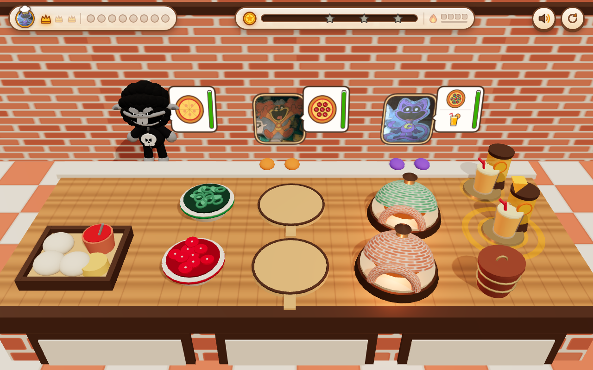

# 🍕🐾 Critter Pizzeria 3D (`小镇大厨` Edition)

**Play Live:** [https://kunruiw1991.github.io/critters-pizzeria3d/](https://kunruiw1991.github.io/critters-pizzeria3d/)

---

## 🎮 Overview & Core Gameplay Loop

**Critter Pizzeria 3D** is a cozy, tactile, 100% zero-text 3D WebGL time-management pizzeria game inspired by *Cooking Marina* (`小镇大厨`), designed to be immediately intuitive for both a 5-year-old child and an adult player.

### 🍕 4 Clear Menu Items
1. **Cheese Pizza (`25` base coins)**: Plump dough + rich tomato sauce + golden mozzarella cheese baked in a brick oven (`3.0s`).
2. **Pepperoni Pizza (`35` base coins)**: Cheese pizza base topped with savory red pepperoni slices (`3.0s` bake).
3. **Supreme Pizza (`45` base coins)**: Cheese pizza base topped with red pepperoni slices + crisp green bell-pepper rings & basil (`3.0s` bake).
4. **Golden Mango Juice (`15` base coins)**: Auto-refilling golden mango juice dispensers (`2.5s` refill) topped with an orange slice and straw when ready.

### 🕹️ Smart 1-Tap & Drag-and-Drop Controls (With Guided Next-Step Highlight Ring)
- **Guided Next-Step Ring**: A pulsing golden base ring + bobbing 3D pointer chevron highlights the optimal next station to tap.
- **Dough & Toppings**: Tap (or drag from) `dough_tray` to place a sauced & cheesed pizza base onto an empty wooden peel (`prep_board_0` or `prep_board_1`) with a `0.25s` parabolic mini-arc flight and squash-and-stretch spring bounce. Tap `topping_pepperoni` or `topping_veggie` to launch toppings onto the prep board.
- **Dual Domed Brick Ovens**: Tap a prepped peel (`prep_board_0..1`) to slide the pizza into the first free brick oven (`oven_0` or `oven_1`). A 3D circular timer ring above the oven fills in green over `3.0s`.
- **Golden Bake, Overbake Warning & Trash Bin**: When baking completes (`state === 'baked'`), a crystal kitchen timer bell chimes and a `7.5s` amber/red burn countdown begins. Tap the baked oven (or drag to a customer) to launch the pizza in a parabolic arc to the matching Smiling Critter customer! If left unserved for `> 7.5s`, the pizza burns (`state === 'burned'`); tap the burned oven or the copper `trash_bin` to clear it.
- **Combo Flame Streak (`1x -> 4x`)**: Completing customer orders within `4.5s` of the previous serve increments the combo flame gauge (`1x -> 2x -> 3x -> 4x`), awarding `+5 * (combo - 1)` bonus coins and transposing the joyful kalimba chomp arpeggio upward.

---

## 🏆 Strict Top-3 Podium Qualification (`🥇 3⭐`, `🥈 2⭐`, `🥉 1⭐`, `4th/5th = 0⭐ Defeat`)

Each of the **3 Waves** serves **8 Smiling Critter customers** (`baba`, `dogday`, `catnap`, `craftycorn`, `hoppy`, `picky`, `bubba`, `kickin`). You play as **Chef CatNap** by default (or tap the **Chef Toque Hat Avatar** in the top-left HUD pill to cycle your Chef character between `catnap`, `dogday`, `craftycorn`, `hoppy`, `picky`, `bubba`, and `kickin`). At the end of each wave, the **Zero-Text 5-Critter Olympic Podium Modal** highlights your Chef Critter with a **White Chef Toque Hat Badge** and compares your coins against 4 rival scores (with **Baba Chops** placed at the 4th rival slot so Baba Chops never steals 1st place):

| Podium Finish | Wave 1 Coins | Wave 2 Coins | Wave 3 Coins | Star Rating | Wave Progression |
| :--- | :--- | :--- | :--- | :--- | :--- |
| **1st Place (`🥇`)** | `coins >= 220` | `coins >= 285` | `coins >= 315` | `⭐⭐⭐` Gold Crown Trophy | Unlocks Next Wave |
| **2nd Place (`🥈`)** | `coins >= 165` | `coins >= 215` | `coins >= 240` | `⭐⭐` Silver Medal | Unlocks Next Wave |
| **3rd Place (`🥉`)** | `coins >= 110` | `coins >= 145` | `coins >= 165` | `⭐` Bronze Medal | Unlocks Next Wave |
| **4th / 5th Place** | `coins < 110` | `coins < 145` | `coins < 165` | `0⭐` Defeat | Next Wave Locked (Retry Only) |

---

## 🛠️ Architecture & Creator + Critic Verification Changelog

- **Engine**: Local Three.js (`models/three.module.min.js`) + procedural 3D Baba Chops plush rig (`models/baba_chops_model.js`) + 100% procedural WebAudio ASMR & kalimba/marimba synthesis (`js/audio.js`).
- **Round 1 (Core Build & Balance)**:
  - Built `index.html`, `js/game.js`, `js/scene3d.js`, and `js/audio.js` with `alphaHanziCount === 0` (`0` text/digits in DOM or Canvas, `0` `speechSynthesis` calls) and `<= 4` visible DOM buttons at any time.
  - `@critic-gameplay` verified the end-to-end cooking/burn/trash/reset loop and 3-policy fast-forward bot balance (`Policy A Idle: 0 coins / 0⭐`, `Policy B Casual Kid: 140–200 coins / 1–2⭐`, `Policy C Skilled Chef: 345–475 coins / 3⭐`).
- **Round 2 (Multi-Viewport Hitbox, Standee Cropping & Portrait HUD Polish)**:
  - Fixed 3D raycast hitbox occlusion in `js/scene3d.js` using counter-level hit discs and staggered station coordinates (`>= 132px` hitboxes across all 9 stations).
  - Framed all Smiling Critter `.webp` portraits into tightly-cropped rounded-arch standee textures and podium avatars (`CRITTER_CROPS`) so order bubbles never overlap character faces.
  - Updated `@media (max-width: 640px)` in `index.html` with a 2x4 customer pip grid and wrapped score bar so `390x844` portrait has `0px` HUD overlap.
- **Round 3 (Tactile Juice, Guided Highlight Ring & Counter Breathing Room)**:
  - Hidden duplicate standee paw spheres when `friend === 'baba'` (`babaPlush` 3D hooves grounded on counter ledge) and increased wood-counter breathing room between `oven_1`'s timer ring and `slot_2`'s paws.
  - Added the pulsing golden `recommendedStationId` guide ring + bobbing 3D pointer chevron and `0.25s` parabolic mini-arc ingredient flights (`spawnFlyingIngredient` + `triggerStationBounce`).
  - Signed off 100% by `@critic-gameplay`, `@critic-ux`, and `@critic-visual`.
